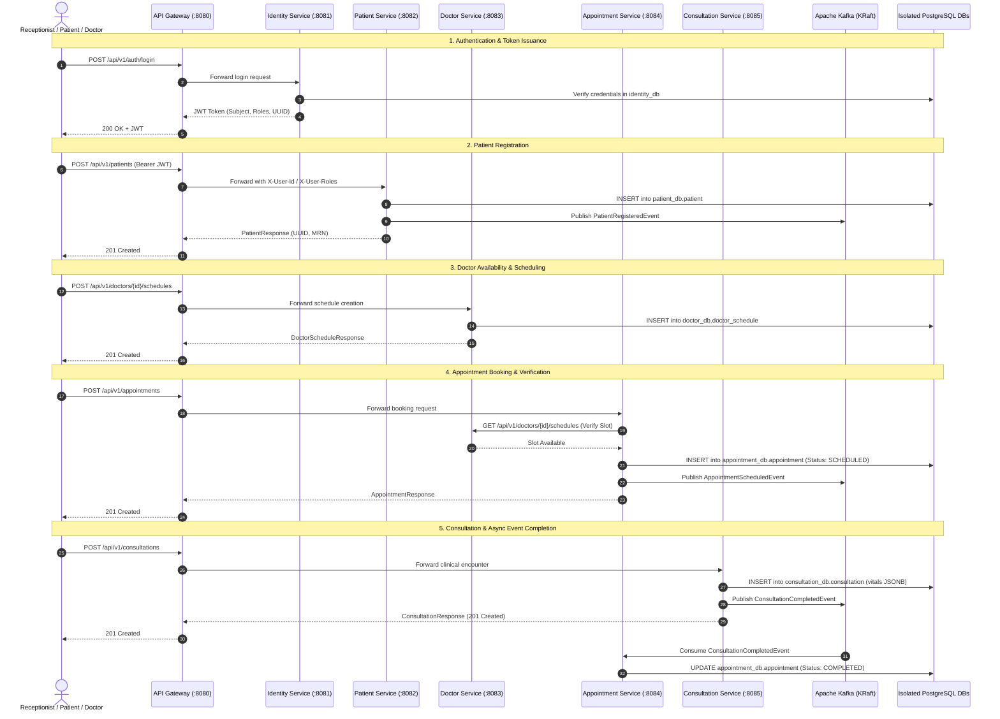

# Hospital Management System (HMS) — Proof of Concept (PoC) Document

## 1. Executive Summary & Objective

The **Hospital Management System (HMS)** is designed as a secure, high-performance, maintainable **backend-only microservices architecture** built using **Java 25**, **Spring Boot**, **Spring Cloud Gateway**, **Spring Data JPA**, **Apache Kafka (KRaft mode)**, **PostgreSQL (Database-per-Service)**, **Flyway**, and **Docker**.

The objective of this Proof of Concept (PoC) is to establish:
1. **Microservices Architecture**: Domain-Driven Design (DDD) bounded contexts decomposed into independent, loosely coupled microservices managed within a Maven multi-module monorepo.
2. **API Ingress & Routing**: Unified entry point via **Spring Cloud Gateway** handling route distribution (`/api/v1`), TLS termination, and security context propagation.
3. **Event-Driven Asynchronous Backbone**: **Apache Kafka (KRaft mode)** for reliable, decoupled event streaming (`PatientRegisteredEvent`, `AppointmentScheduledEvent`, `ConsultationCompletedEvent`) without distributed two-phase commit bottlenecks.
4. **Database-per-Service & Schema Migrations**: Isolated PostgreSQL databases per service with dedicated, reviewable Flyway migration streams and logical UUID identifiers avoiding cross-database joins and physical foreign keys.
5. **Clean Domain Modeling & Contracts**: Rich domain models with strict business invariants, immutable Java Records for DTOs/Events, Bean Validation, RBAC authorization, and centralized error handling.
6. **Containerized Orchestration**: Complete local development stack orchestrating all microservices, PostgreSQL databases, and Kafka via Docker Compose.
7. **Quality & Verification Standards**: Testing pyramid featuring JUnit 5 unit tests and Testcontainers for real PostgreSQL and Kafka broker verification.

---

## 2. System Architecture & Service Boundaries

### 2.1 Architectural Paradigm: Microservices Architecture
The system is divided into autonomous business services, each with its own runtime process, build lifecycle, and dedicated database. Communication follows two distinct patterns:
* **Synchronous (REST/HTTP Interfaces with Resilience4j)**: Used for immediate request-reply queries where strong real-time validation is required (e.g. Appointment Service verifying Doctor schedule availability).
* **Asynchronous (Apache Kafka Events)**: Used for state notifications, cross-service workflows, audit trails, and downstream integration (e.g. Consultation completion notifying Appointment status and Billing).

```
hospital/
├── pom.xml (Parent Aggregator POM & Dependency Management)
├── common/ (Shared module: Event DTOs, Security filters, Centralized error models)
├── services/
│   ├── api-gateway/          # Port 8080: Routing, Ingress, Rate-limiting
│   ├── identity-service/     # Port 8081, DB: identity_db (Auth, Users, Roles, JWT)
│   ├── patient-service/      # Port 8082, DB: patient_db (Demographics, MRN)
│   ├── doctor-service/       # Port 8083, DB: doctor_db (Specialization, Schedules)
│   ├── appointment-service/  # Port 8084, DB: appointment_db (Booking, Slot FSM)
│   ├── consultation-service/ # Port 8085, DB: consultation_db (Encounter notes, Vitals JSONB)
│   ├── billing-service/      # (Phase 2) Port 8086, DB: billing_db (Invoices, Payments)
│   └── notification-service/ # (Phase 2) Port 8087 (Outbound Email/SMS Kafka Consumer)
└── docker-compose.yml        # Orchestration for Services, PostgreSQL, and Kafka
```

### 2.2 Standard Microservice Internal Structure
Every microservice adheres to 4 internal layers:
```
<service>/
├── api/               # REST Controllers, Request/Response DTO records
├── application/       # Application Services, Orchestration, Local Transaction boundaries
├── domain/            # Entities, Value Objects, Domain Events, Enums, Domain Services
└── infrastructure/   # Spring Data Repositories, Kafka Producers/Consumers, External Clients
```

---

## 3. PoC Scope: Core Business Flows

The initial PoC focuses on a cohesive core workflow involving **API Gateway**, **Identity Service**, **Patient Service**, **Doctor Service**, **Appointment Service**, **Consultation Service**, and the **Apache Kafka Event Bus**:



---

## 4. Domain Models & Invariants

Each microservice encapsulates its own aggregate roots and invariants. Logical cross-service links use UUIDs rather than database-enforced foreign keys.

### 4.1 Identity Service
* **Roles**: `ADMIN`, `DOCTOR`, `NURSE`, `RECEPTIONIST`, `PHARMACIST`, `LAB_TECHNICIAN`, `BILLING_STAFF`.
* **Entities**: `UserAccount` (UUID `id`, unique `username`, unique `email`, `password_hash`, `active`, `roles`).
* **Invariants**: Passwords must never be logged or stored in plaintext; user must possess at least one valid role; inactive users cannot authenticate.

### 4.2 Patient Service
* **Entities & Value Objects**:
  * `Patient` (UUID `id`, Medical Record Number `MRN`, `firstName`, `lastName`, `dateOfBirth`, `gender`, `phone`, `email`, `address`).
  * `EmergencyContact` (Value Object: `name`, `relationship`, `phone`).
* **Invariants**: Unique MRN across the healthcare system; immutable birth date; valid phone/contact info.
* **Kafka Event Produced**: `PatientRegisteredEvent` (UUID `patientId`, `mrn`, `fullName`, `email`, `timestamp`).

### 4.3 Doctor Service
* **Entities & Value Objects**:
  * `Doctor` (UUID `id`, UUID `userId`, `licenseNumber`, `firstName`, `lastName`, `specialization`, `department`, `active`).
  * `DoctorSchedule` (UUID `id`, UUID `doctorId`, `dayOfWeek`, `startTime`, `endTime`, `slotDurationMinutes`).
* **Invariants**: Unique medical license number; non-overlapping schedule blocks.

### 4.4 Appointment Service
* **Entities & Value Objects**:
  * `Appointment` (UUID `id`, UUID `patientId`, UUID `doctorId`, `startTime`, `endTime`, `type`, `status`, `reason`, `cancellationReason`).
* **State Machine**:
  $$\text{SCHEDULED} \xrightarrow{\text{confirm}} \text{CONFIRMED} \xrightarrow{\text{start}} \text{IN\_PROGRESS} \xrightarrow{\text{complete}} \text{COMPLETED}$$
  $$\text{SCHEDULED / CONFIRMED} \xrightarrow{\text{cancel}} \text{CANCELLED}$$
  $$\text{SCHEDULED / CONFIRMED} \xrightarrow{\text{miss}} \text{NO\_SHOW}$$
* **Invariants**: Cannot book appointments in past timestamps; doctor cannot have overlapping active appointments; cancellations require a documented reason.
* **Kafka Events**:
  - Produced: `AppointmentScheduledEvent`, `AppointmentCancelledEvent`.
  - Consumed: `ConsultationCompletedEvent` (triggers transition to `COMPLETED`).

### 4.5 Consultation Service
* **Entities & Value Objects**:
  * `Consultation` (UUID `id`, UUID `appointmentId`, UUID `doctorId`, UUID `patientId`, `chiefComplaint`, `diagnosis`, `clinicalNotes`, `vitals`).
  * `Vitals` (Structured JSONB: `temperatureCelsius`, `systolicBp`, `diastolicBp`, `pulseRateBpm`, `respiratoryRate`, `oxygenSaturationPct`).
* **Invariants**: Vitals must adhere to physiological boundary constraints; diagnosis and chief complaint cannot be empty.
* **Kafka Event Produced**: `ConsultationCompletedEvent` (UUID `consultationId`, UUID `appointmentId`, UUID `patientId`, UUID `doctorId`, `diagnosis`, `timestamp`).

---

## 5. Database-per-Service & Flyway Strategy

### 5.1 Principles
* Each microservice owns its private PostgreSQL database. No microservice is allowed to query another service's database directly.
* Foreign keys across services are strictly logical (UUIDs), not database constraints.
* Every database evolution is versioned with dedicated Flyway scripts.

### 5.2 Schema Definitions

#### `identity_db` (`identity-service` — `V1__init_identity.sql`)
```sql
CREATE TABLE app_user (
    id UUID PRIMARY KEY DEFAULT gen_random_uuid(),
    username VARCHAR(100) NOT NULL UNIQUE,
    email VARCHAR(255) NOT NULL UNIQUE,
    password_hash VARCHAR(255) NOT NULL,
    active BOOLEAN NOT NULL DEFAULT TRUE,
    created_at TIMESTAMP WITH TIME ZONE NOT NULL DEFAULT CURRENT_TIMESTAMP,
    updated_at TIMESTAMP WITH TIME ZONE NOT NULL DEFAULT CURRENT_TIMESTAMP
);

CREATE TABLE user_role (
    user_id UUID NOT NULL REFERENCES app_user(id) ON DELETE CASCADE,
    role VARCHAR(50) NOT NULL,
    PRIMARY KEY (user_id, role)
);
```

#### `patient_db` (`patient-service` — `V1__init_patient.sql`)
```sql
CREATE TABLE patient (
    id UUID PRIMARY KEY DEFAULT gen_random_uuid(),
    mrn VARCHAR(50) NOT NULL UNIQUE,
    first_name VARCHAR(100) NOT NULL,
    last_name VARCHAR(100) NOT NULL,
    date_of_birth DATE NOT NULL,
    gender VARCHAR(20) NOT NULL,
    phone VARCHAR(20) NOT NULL,
    email VARCHAR(255),
    address_line1 VARCHAR(255),
    city VARCHAR(100),
    postal_code VARCHAR(20),
    emergency_contact_name VARCHAR(100),
    emergency_contact_phone VARCHAR(20),
    emergency_contact_relation VARCHAR(50),
    created_at TIMESTAMP WITH TIME ZONE NOT NULL DEFAULT CURRENT_TIMESTAMP,
    updated_at TIMESTAMP WITH TIME ZONE NOT NULL DEFAULT CURRENT_TIMESTAMP
);

CREATE INDEX idx_patient_phone ON patient(phone);
CREATE INDEX idx_patient_names ON patient(last_name, first_name);
```

#### `doctor_db` (`doctor-service` — `V1__init_doctor.sql`)
```sql
CREATE TABLE doctor (
    id UUID PRIMARY KEY DEFAULT gen_random_uuid(),
    user_id UUID NOT NULL UNIQUE, -- Logical reference to identity_service app_user.id
    license_number VARCHAR(100) NOT NULL UNIQUE,
    first_name VARCHAR(100) NOT NULL,
    last_name VARCHAR(100) NOT NULL,
    specialization VARCHAR(100) NOT NULL,
    department VARCHAR(100) NOT NULL,
    active BOOLEAN NOT NULL DEFAULT TRUE,
    created_at TIMESTAMP WITH TIME ZONE NOT NULL DEFAULT CURRENT_TIMESTAMP,
    updated_at TIMESTAMP WITH TIME ZONE NOT NULL DEFAULT CURRENT_TIMESTAMP
);

CREATE TABLE doctor_schedule (
    id UUID PRIMARY KEY DEFAULT gen_random_uuid(),
    doctor_id UUID NOT NULL REFERENCES doctor(id) ON DELETE CASCADE,
    day_of_week VARCHAR(20) NOT NULL,
    start_time TIME NOT NULL,
    end_time TIME NOT NULL,
    slot_duration_minutes INT NOT NULL DEFAULT 30,
    created_at TIMESTAMP WITH TIME ZONE NOT NULL DEFAULT CURRENT_TIMESTAMP
);

CREATE INDEX idx_schedule_doctor ON doctor_schedule(doctor_id);
```

#### `appointment_db` (`appointment-service` — `V1__init_appointment.sql`)
```sql
CREATE TABLE appointment (
    id UUID PRIMARY KEY DEFAULT gen_random_uuid(),
    patient_id UUID NOT NULL, -- Logical reference to patient_service patient.id
    doctor_id UUID NOT NULL,  -- Logical reference to doctor_service doctor.id
    start_time TIMESTAMP WITH TIME ZONE NOT NULL,
    end_time TIMESTAMP WITH TIME ZONE NOT NULL,
    type VARCHAR(30) NOT NULL,
    status VARCHAR(30) NOT NULL,
    reason VARCHAR(500),
    cancellation_reason VARCHAR(500),
    created_at TIMESTAMP WITH TIME ZONE NOT NULL DEFAULT CURRENT_TIMESTAMP,
    updated_at TIMESTAMP WITH TIME ZONE NOT NULL DEFAULT CURRENT_TIMESTAMP
);

CREATE INDEX idx_appointment_doctor_time ON appointment(doctor_id, start_time, end_time);
CREATE INDEX idx_appointment_patient_time ON appointment(patient_id, start_time);
```

#### `consultation_db` (`consultation-service` — `V1__init_consultation.sql`)
```sql
CREATE TABLE consultation (
    id UUID PRIMARY KEY DEFAULT gen_random_uuid(),
    appointment_id UUID NOT NULL UNIQUE, -- Logical reference to appointment_service appointment.id
    patient_id UUID NOT NULL,            -- Logical reference to patient_service patient.id
    doctor_id UUID NOT NULL,             -- Logical reference to doctor_service doctor.id
    chief_complaint TEXT NOT NULL,
    diagnosis TEXT NOT NULL,
    clinical_notes TEXT,
    vitals JSONB,
    created_at TIMESTAMP WITH TIME ZONE NOT NULL DEFAULT CURRENT_TIMESTAMP,
    updated_at TIMESTAMP WITH TIME ZONE NOT NULL DEFAULT CURRENT_TIMESTAMP
);

CREATE INDEX idx_consultation_patient ON consultation(patient_id);
```

---

## 6. Apache Kafka Event Streaming Specifications

### 6.1 Topics & Event Contracts

| Topic Name | Producer Service | Consumers | Payload Schema (Record) |
| :--- | :--- | :--- | :--- |
| `hospital.patient.events` | `patient-service` | `notification-service`, Audit | `PatientRegisteredEvent(eventId, patientId, mrn, fullName, email, occurredAt)` |
| `hospital.appointment.events` | `appointment-service` | `notification-service`, `billing-service` | `AppointmentScheduledEvent(eventId, appointmentId, patientId, doctorId, startTime, endTime, type, occurredAt)` |
| `hospital.consultation.events` | `consultation-service` | `appointment-service`, `billing-service` | `ConsultationCompletedEvent(eventId, consultationId, appointmentId, patientId, doctorId, diagnosis, occurredAt)` |

### 6.2 Serialization & Reliability
- **Serialization**: JSON using Jackson with `JavaTimeModule` via Spring Kafka's `JsonSerializer` / `JsonDeserializer`.
- **Idempotency**: All consumers verify the event ID or current aggregate state to prevent duplicate processing.
- **Error Handling**: Configured with Spring Kafka `DefaultErrorHandler` using exponential backoff and Dead-Letter Topics (DLT).

---

## 7. REST API & Gateway Routing Contracts

All external clients communicate exclusively with the **API Gateway** on port `8080`.

### 7.1 Gateway Routes Configuration
| Public Path | Target Downstream Service | Downstream Port | Auth Required |
| :--- | :--- | :--- | :--- |
| `/api/v1/auth/**` | `identity-service` | 8081 | No |
| `/api/v1/patients/**` | `patient-service` | 8082 | Yes (`RECEPTIONIST`, `ADMIN`, `DOCTOR`) |
| `/api/v1/doctors/**` | `doctor-service` | 8083 | Yes (`ADMIN`, `DOCTOR`, `RECEPTIONIST`) |
| `/api/v1/appointments/**` | `appointment-service` | 8084 | Yes (`RECEPTIONIST`, `PATIENT`, `ADMIN`, `DOCTOR`) |
| `/api/v1/consultations/**` | `consultation-service` | 8085 | Yes (`DOCTOR`, `NURSE`) |

### 7.2 Core Endpoints Summary
* **Auth**:
  - `POST /api/v1/auth/login` — Authenticate and retrieve JWT
  - `POST /api/v1/auth/register` — Create staff user account
* **Patients**:
  - `POST /api/v1/patients` — Register new patient (`201 Created`)
  - `GET /api/v1/patients/{id}` — Fetch patient details (`200 OK`)
  - `GET /api/v1/patients?page=0&size=20` — Paginated directory (`200 OK`)
* **Doctors**:
  - `POST /api/v1/doctors` — Register doctor profile (`201 Created`)
  - `POST /api/v1/doctors/{id}/schedules` — Configure schedule blocks (`201 Created`)
  - `GET /api/v1/doctors/{id}/schedules` — Query availability slots (`200 OK`)
* **Appointments**:
  - `POST /api/v1/appointments` — Book new appointment slot (`201 Created`)
  - `GET /api/v1/appointments/{id}` — Get appointment details (`200 OK`)
  - `POST /api/v1/appointments/{id}/cancel` — Cancel appointment with reason (`200 OK`)
* **Consultations**:
  - `POST /api/v1/consultations` — Record clinical encounter & vitals (`201 Created`)
  - `GET /api/v1/consultations/{id}` — Retrieve consultation with vitals (`200 OK`)

---

## 8. Security & Context Propagation

1. **Edge Gateway Validation**:
   - The API Gateway validates incoming JWT signatures, expiration, and issuer.
   - Gateway populates HTTP headers forwarded downstream:
     - `X-User-Id`: Authenticated user UUID
     - `X-User-Roles`: Comma-separated roles (e.g. `ROLE_DOCTOR,ROLE_ADMIN`)
2. **Service-Level Defense-in-Depth**:
   - Each microservice validates the propagated headers or JWT claims and enforces method security via `@PreAuthorize("hasRole('ROLE_...')")`.
3. **Audit Logging & Privacy**:
   - Patient Protected Health Information (PHI) is never logged in plaintext.
   - State-modifying operations log `userId`, `action`, `resourceId`, and `timestamp`.

---

## 9. Centralized Error Handling

Each microservice formats errors consistently:
```json
{
  "code": "APPOINTMENT_SLOT_UNAVAILABLE",
  "message": "Doctor already has a scheduled appointment in the selected time range.",
  "timestamp": "2026-09-04T12:00:00Z",
  "path": "/api/v1/appointments"
}
```

Standardized Error Codes:
- `RESOURCE_NOT_FOUND` (404)
- `VALIDATION_FAILED` (400)
- `DOMAIN_RULE_VIOLATION` (422)
- `UNAUTHORIZED_ACCESS` (401)
- `FORBIDDEN_OPERATION` (403)
- `CONFLICTING_STATE` (409)
- `INTERNAL_SERVER_ERROR` (500)

---

## 10. Containerization & Docker Infrastructure

### 10.1 Multi-Service Docker Compose (`docker-compose.yml`)

The development environment orchestrates PostgreSQL, Apache Kafka (KRaft), and all microservices:

```yaml
version: '3.8'

services:
  postgres:
    image: postgres:16-alpine
    container_name: hms-postgres
    restart: unless-stopped
    environment:
      POSTGRES_USER: hms_user
      POSTGRES_PASSWORD: hms_password
      POSTGRES_MULTIPLE_DATABASES: identity_db,patient_db,doctor_db,appointment_db,consultation_db
    ports:
      - "5432:5432"
    volumes:
      - postgres_data:/var/lib/postgresql/data
      - ./init-multiple-databases.sh:/docker-entrypoint-initdb.d/init-multiple-databases.sh:ro
    healthcheck:
      test: ["CMD-SHELL", "pg_isready -U hms_user"]
      interval: 5s
      timeout: 5s
      retries: 5

  kafka:
    image: confluentinc/cp-kafka:7.7.0
    container_name: hms-kafka
    restart: unless-stopped
    ports:
      - "9092:9092"
    environment:
      KAFKA_NODE_ID: 1
      KAFKA_LISTENER_SECURITY_PROTOCOL_MAP: 'CONTROLLER:PLAINTEXT,PLAINTEXT:PLAINTEXT,PLAINTEXT_HOST:PLAINTEXT'
      KAFKA_ADVERTISED_LISTENERS: 'PLAINTEXT://kafka:29092,PLAINTEXT_HOST://localhost:9092'
      KAFKA_OFFSETS_TOPIC_REPLICATION_FACTOR: 1
      KAFKA_GROUP_INITIAL_REBALANCE_DELAY_MS: 0
      KAFKA_TRANSACTION_STATE_LOG_MIN_ISR: 1
      KAFKA_TRANSACTION_STATE_LOG_REPLICATION_FACTOR: 1
      KAFKA_PROCESS_ROLES: 'broker,controller'
      KAFKA_CONTROLLER_QUORUM_VOTERS: '1@kafka:29093'
      KAFKA_LISTENERS: 'PLAINTEXT://0.0.0.0:29092,CONTROLLER://0.0.0.0:29093,PLAINTEXT_HOST://0.0.0.0:9092'
      KAFKA_INTER_BROKER_LISTENER_NAME: 'PLAINTEXT'
      KAFKA_CONTROLLER_LISTENER_NAMES: 'CONTROLLER'
      KAFKA_LOG_DIRS: '/tmp/kraft-combined-logs'
      CLUSTER_ID: 'MkU3OEVBNTcwNTJENDM2Qk'

  api-gateway:
    build:
      context: .
      dockerfile: services/api-gateway/Dockerfile
    container_name: hms-api-gateway
    ports:
      - "8080:8080"
    depends_on:
      - identity-service
      - patient-service
      - doctor-service
      - appointment-service
      - consultation-service

  identity-service:
    build:
      context: .
      dockerfile: services/identity-service/Dockerfile
    container_name: hms-identity-service
    ports:
      - "8081:8081"
    depends_on:
      postgres:
        condition: service_healthy

  patient-service:
    build:
      context: .
      dockerfile: services/patient-service/Dockerfile
    container_name: hms-patient-service
    ports:
      - "8082:8082"
    depends_on:
      postgres:
        condition: service_healthy
      kafka:
        condition: service_started

  doctor-service:
    build:
      context: .
      dockerfile: services/doctor-service/Dockerfile
    container_name: hms-doctor-service
    ports:
      - "8083:8083"
    depends_on:
      postgres:
        condition: service_healthy

  appointment-service:
    build:
      context: .
      dockerfile: services/appointment-service/Dockerfile
    container_name: hms-appointment-service
    ports:
      - "8084:8084"
    depends_on:
      postgres:
        condition: service_healthy
      kafka:
        condition: service_started

  consultation-service:
    build:
      context: .
      dockerfile: services/consultation-service/Dockerfile
    container_name: hms-consultation-service
    ports:
      - "8085:8085"
    depends_on:
      postgres:
        condition: service_healthy
      kafka:
        condition: service_started

volumes:
  postgres_data:
    driver: local
```

---

## 11. Testing & Verification Strategy

Following the testing pyramid:
1. **Unit Tests (JUnit 5 & Mockito)**:
   - Domain logic and state machine transitions (e.g. appointment cancellations, slot validation).
   - Kafka event serialization and payload integrity.
2. **Integration Tests (Spring Boot Test & Testcontainers)**:
   - Run isolated PostgreSQL Testcontainers for Flyway migration validation.
   - Run Testcontainers Kafka broker (`org.testcontainers:kafka`) to verify end-to-end event publishing and consumption.
3. **Gateway & API Contract Tests (`@WebMvcTest` & MockMvc)**:
   - Verify request validation, HTTP status codes, and security filter enforcement.

---

## 12. Technical Stack & Dependencies

| Component | Library / Framework | Version / Scope |
| :--- | :--- | :--- |
| **Java Runtime** | Java 25 (Eclipse Temurin / OpenJDK) | Java 25 LTS Standard |
| **Parent Framework** | Spring Boot | 4.1.x Starter Parent |
| **Cloud & Routing** | Spring Cloud Gateway (MVC/Reactive) | Spring Cloud Release Train |
| **Event Streaming** | Spring Kafka (`spring-kafka`) & Apache Kafka (KRaft) | Confluent CP Kafka 7.7.0 |
| **Persistence & ORM** | Spring Data JPA / Hibernate | Included in Starter |
| **Relational DB** | PostgreSQL 16 | PostgreSQL JDBC Driver |
| **Database Migrations**| Flyway Core + Flyway PostgreSQL | Build / Runtime per service |
| **Validation** | Spring Boot Starter Validation | Hibernate Validator |
| **Security** | Spring Boot Starter Security + JJWT | Compile |
| **Integration Testing**| Testcontainers PostgreSQL & Testcontainers Kafka | Test Scope |

---

## 13. PoC Execution Phases

1. **Phase 1: Multi-Module Maven Setup & Parent POM**
   - Configure root `pom.xml` with `<packaging>pom</packaging>` and dependency management for Spring Boot, Spring Cloud, Kafka, and Testcontainers.
2. **Phase 2: Common Library (`common`)**
   - Event contracts (`PatientRegisteredEvent`, `AppointmentScheduledEvent`, `ConsultationCompletedEvent`), shared error DTOs, and security utilities.
3. **Phase 3: Docker & Kafka Infrastructure**
   - Multi-database PostgreSQL initialization script and Kafka KRaft Docker Compose configuration.
4. **Phase 4: Identity & Patient Microservices**
   - `identity-service` (JWT issuance, Flyway `V1`) and `patient-service` (MRN generation, Flyway `V1`, Kafka Producer).
5. **Phase 5: Doctor, Appointment & Consultation Services**
   - `doctor-service` (schedules), `appointment-service` (slot booking, Kafka Producer/Consumer), and `consultation-service` (vitals JSONB, Kafka Producer).
6. **Phase 6: Spring Cloud Gateway**
   - Configure routes, port mapping (`8080`), and security context forwarding.
7. **Phase 7: End-to-End Testing & Verification**
   - Verify complete patient journey across gateway, microservices, and Kafka event streaming.
